<div align="center">

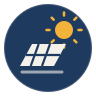

# SunPlot 3D

**Plan solar PV in 3D, right in your browser.**

Lay modules out on a house, a flat roof, a carport, a bus shelter, an airport or open land,
on ten years of real climate data. Click to install module by module, see the shade, the
rain and the snow, and send the client a proposal in one click. No install, no plugin.

[](https://react.dev)
[](https://threejs.org)
[](https://github.com/pmndrs/react-three-fiber)
[](https://vitejs.dev)
[](https://nodejs.org)
[](https://sunplot-3d.imlistack.workers.dev)
[](https://power.larc.nasa.gov/)

**[▶ Open the live app](https://sunplot-3d.imlistack.workers.dev)**

[Features](#-features) · [Quick start](#-quick-start) · [Shortcuts](#-keyboard-shortcuts) · [How it works](#-how-it-works) · [Project structure](#-project-structure) · [Roadmap](#-roadmap)

<br />

<picture>
  <source media="(prefers-color-scheme: dark)" srcset="docs/screenshots/overview-dark.jpg" />
  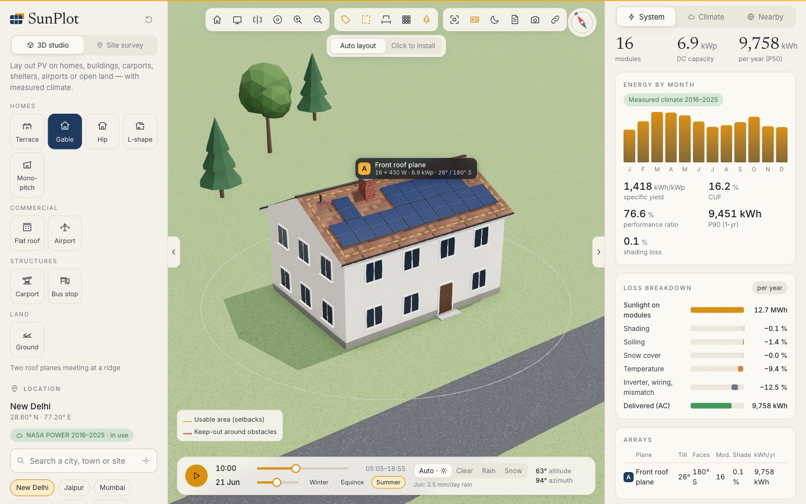
</picture>

<sub>The hero image follows your GitHub theme — light or dark.</sub>

</div>

<br />

## ✦ Demo

<div align="center">
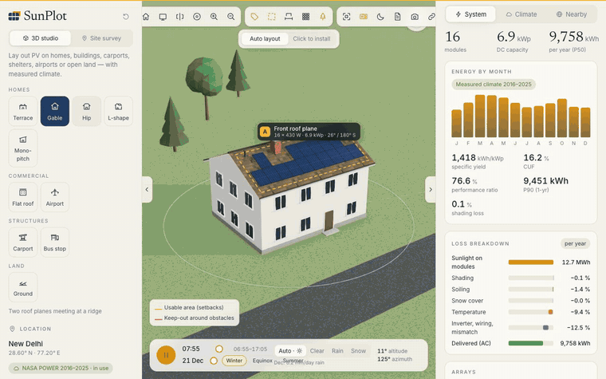
<br />
<sub>38 seconds: studio → airport → carport → click to install → snow → site survey → 3D studio · <a href="docs/demo.mp4">full-quality MP4</a></sub>
</div>

## ✦ At a glance

<table>
  <tr>
    <td align="center"><b>9</b><br /><sub>site types</sub></td>
    <td align="center"><b>10 years</b><br /><sub>of measured climate</sub></td>
    <td align="center"><b>~1 s</b><br /><sub>to ray-cast 3,250 modules</sub></td>
    <td align="center"><b>5</b><br /><sub>install tools + undo</sub></td>
    <td align="center"><b>5-page</b><br /><sub>client proposal PDF</sub></td>
  </tr>
</table>

<table>
  <tr>
    <td width="50%">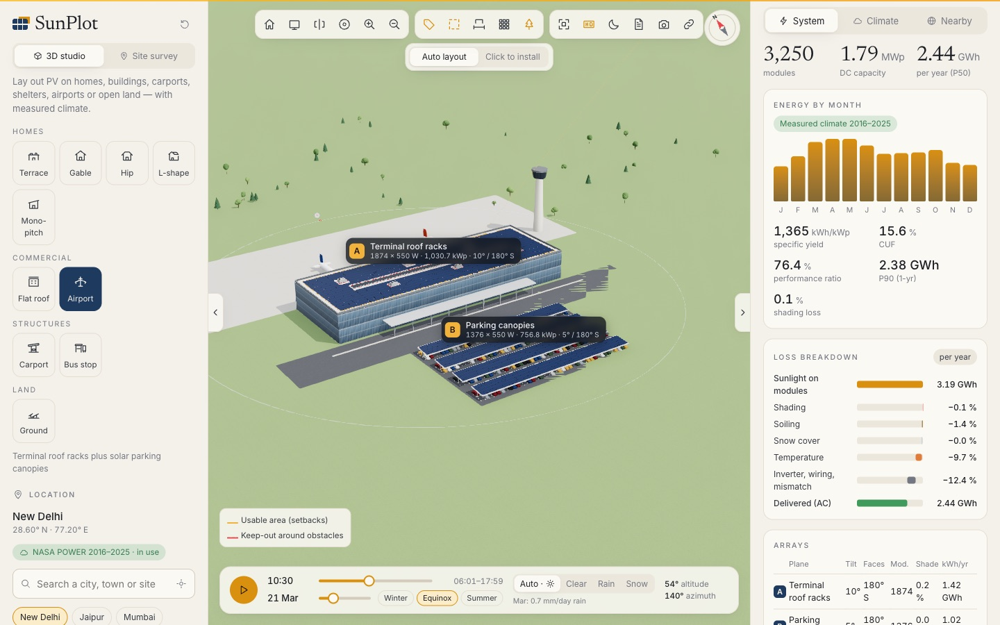</td>
    <td width="50%">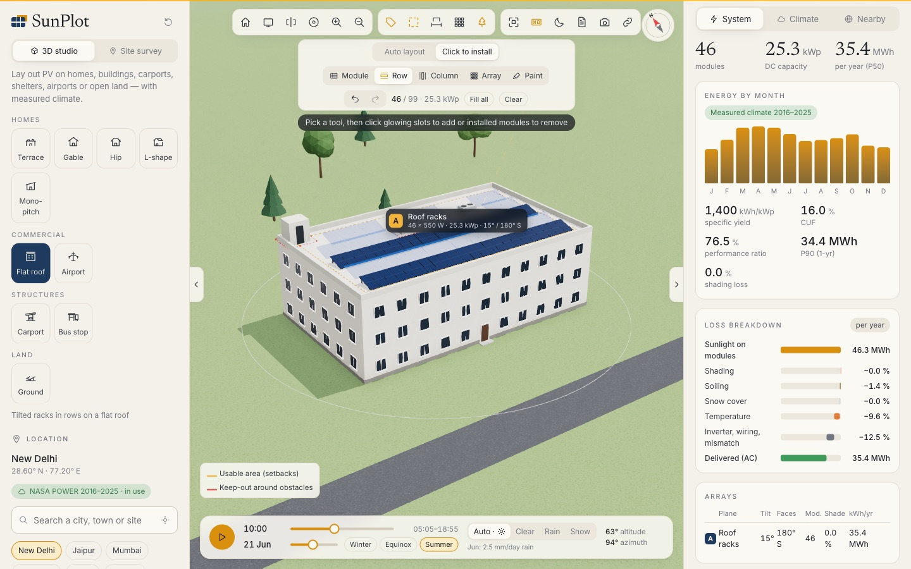</td>
  </tr>
  <tr>
    <td align="center"><sub><b>Airport</b> — 1.8 MWp over the terminal roof and car park</sub></td>
    <td align="center"><sub><b>Click to install</b> — by module, row, column, array or paint</sub></td>
  </tr>
</table>

## ✦ Features

**Design**
- **Nine site types** — gable, hip, L-shaped and mono-pitch houses; flat roofs with tilted racks;
  an airport terminal with forecourt car-park canopies; solar carports (T / Y frames); bus shelters;
  ground-mounted tables.
- **Code-aware auto layout** — ridge and edge setbacks (IFC/IRC 18″ / 36″), hip and valley clearances,
  keep-outs round chimneys, vents, HVAC and stair housings; side planes under 4 modules are skipped.
- **Rows that don't shade each other** — pitch set from the winter-solstice noon sun.
- **Click to install** — glowing slots show every place a module fits. Install or remove one module,
  a row, a column, a whole array, or paint across slots with a drag. Undo / redo, Fill all, Clear.

**Energy**
- **Ten years of NASA POWER weather** for any place on Earth — monthly irradiance, temperature, rain,
  snowfall, snow depth — with **P50 / P90** from the spread of the years.
- **Ray-cast shading** — every module centre against trees, other rows, roof planes and obstacles,
  every half hour on a mid-month day, in a Web Worker. Shade % per array and a module heat-map.
- **Rain, dust and snow** — soiling from dust rate, rain events and your cleaning interval; snow cover
  from snowfall, tilt and temperature; heat loss from measured air temperature.
- **Loss waterfall** — sunlight on modules → shading → soiling → snow → temperature → system → AC.

**See**
- **Live sun** — solar time and date sliders, play the day, sun path, real shadows.
- **Weather in 3D** — Auto shows the month's typical weather from the data; or force rain or snow
  (rain streaks, snowfall, snow on roofs, ground and the lower edge of each module).
- **Engineering overlays** — usable-area outlines, red keep-outs, lettered array tags, dimensions,
  HUD compass. Ambient occlusion and reflections, with a quality switch for slower devices.

**Survey (India)**
- **Site survey without a visit** — type-ahead address search (Photon / OpenStreetMap), use-my-location
  with a blue dot, a draggable pin; then click the building outline on satellite imagery (Overture Maps,
  OpenStreetMap as backup) or draw it, and mark the stair room, water tank and street side.
- **Bill → system** — monthly units (or ₹ bill), sanctioned load and state give the size, number of
  DCR modules, PM Surya Ghar subsidy (₹78,000 cap, special-category states), cost after subsidy and payback.
- **Where on the roof** — front / back / left / right / centre of the terrace ranked by shade from
  neighbouring buildings, the stair room, tank and parapet; the least-shaded spots drawn on the map.
- **Survey public buildings** — filter schools, colleges, hospitals, banks, supermarkets (DMart, Big Bazaar,
  Reliance Smart…), malls, petrol pumps and hotels from Overture Maps places; pick one from the nearby list
  and SunPlot flies there, selects its building, sizes from a typical monthly use for that kind of site and
  explains the non-home route (RESCO / PPA, accelerated depreciation) instead of the home subsidy.
- **3D survey map** — one click extrudes every building to its mapped height, with the chosen roof in amber
  and the suggested modules sitting on top.
- **Open in the 3D studio** with the recommended modules installed — school, hospital, retail, office and
  petrol-pump facades with the building's name board — and a site-survey page in the PDF.

**Share**
- **Client proposal (PDF)** — 3D view, north-up plan, arrays, monthly energy, loss waterfall, P90,
  site climate and 25-year financials, in one click.
- **Real installations** — solar plants mapped in OpenStreetMap near your site, and landmark
  projects (Bhadla, Pavagada, Cochin airport, Noor Abu Dhabi, Benban…) you can load.
- **Shareable links**, PNG export, light & dark themes, fold-away side panels, phone layout.

<table>
  <tr>
    <td width="33%">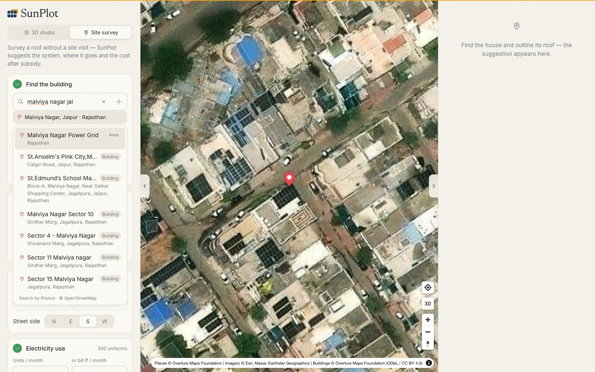</td>
    <td width="33%">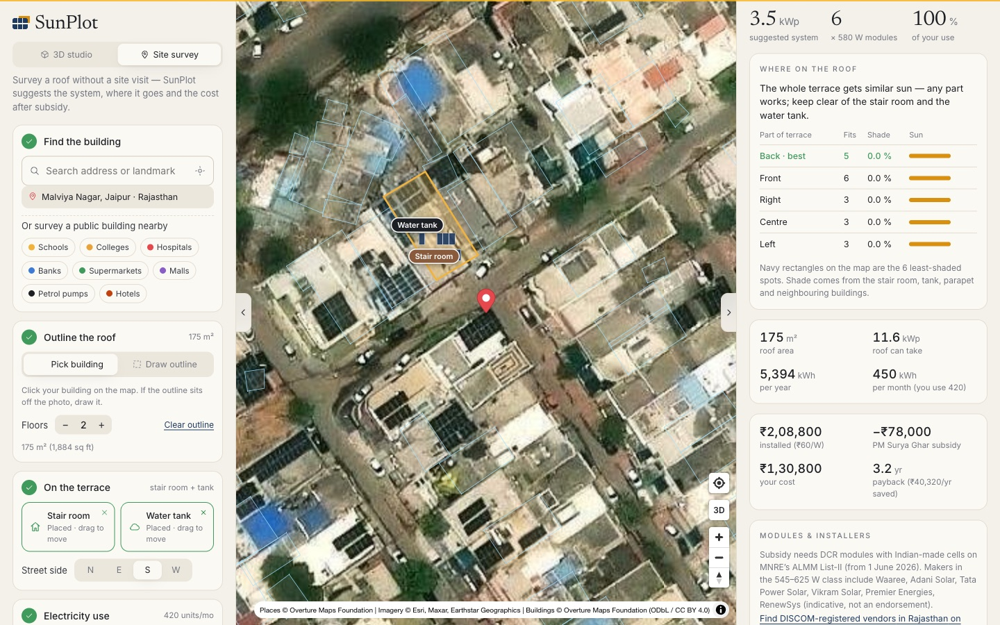</td>
    <td width="33%">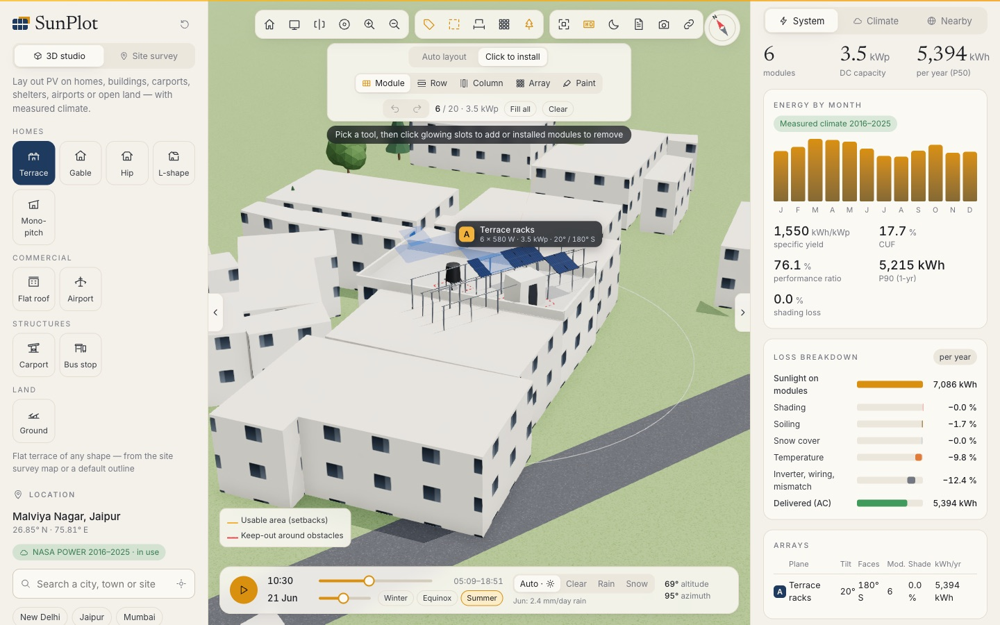</td>
  </tr>
  <tr>
    <td align="center"><sub><b>Find the house</b> — type-ahead + pin</sub></td>
    <td align="center"><sub><b>Survey</b> — 3.5 kWp, ₹78,000 subsidy</sub></td>
    <td align="center"><sub><b>Opened in 3D</b> — neighbours, tank, elevated racks</sub></td>
  </tr>
  <tr>
    <td width="33%">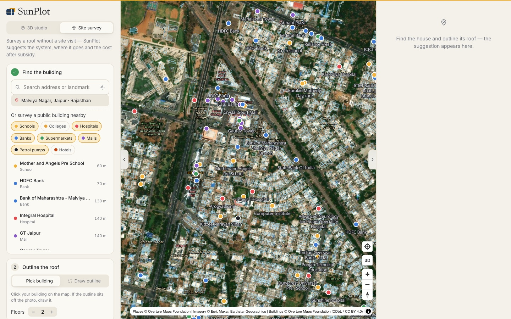</td>
    <td width="33%">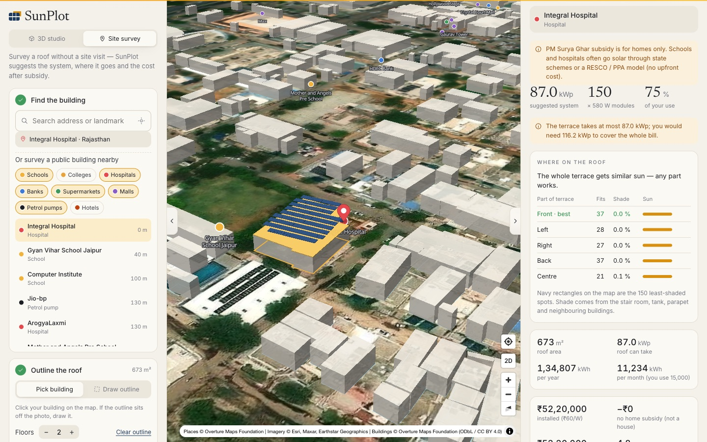</td>
    <td width="33%">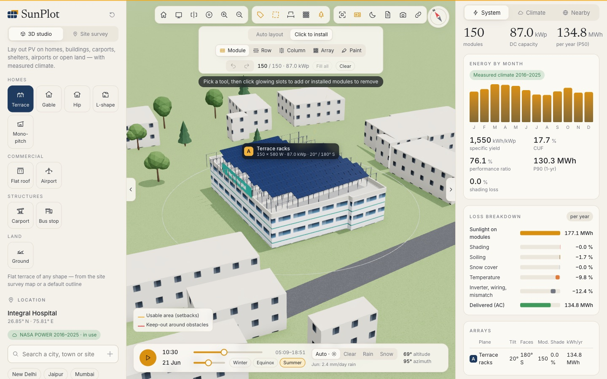</td>
  </tr>
  <tr>
    <td align="center"><sub><b>Public buildings</b> — schools, hospitals, malls…</sub></td>
    <td align="center"><sub><b>3D map</b> — mapped heights, roof in amber</sub></td>
    <td align="center"><sub><b>In the studio</b> — hospital facade + name board</sub></td>
  </tr>
</table>

<table>
  <tr>
    <td width="33%">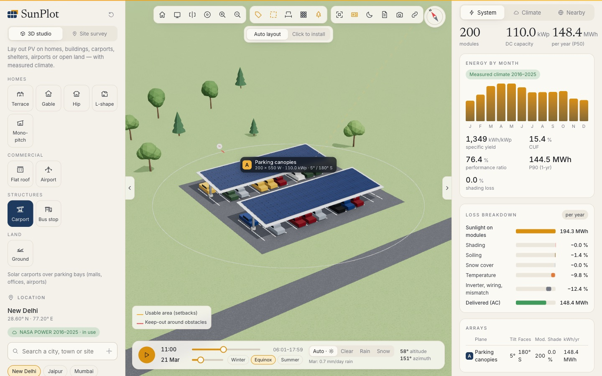</td>
    <td width="33%">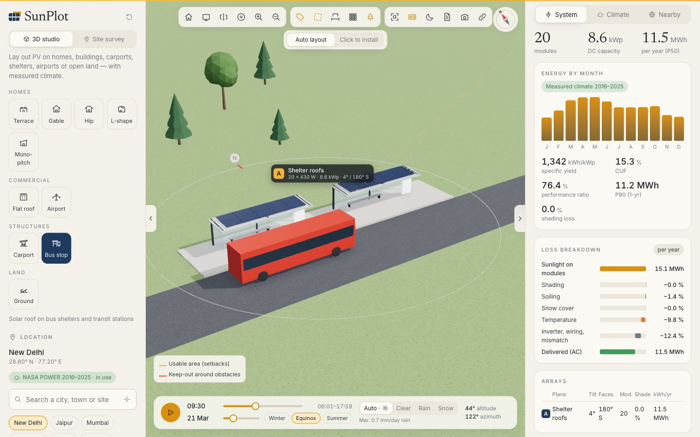</td>
    <td width="33%">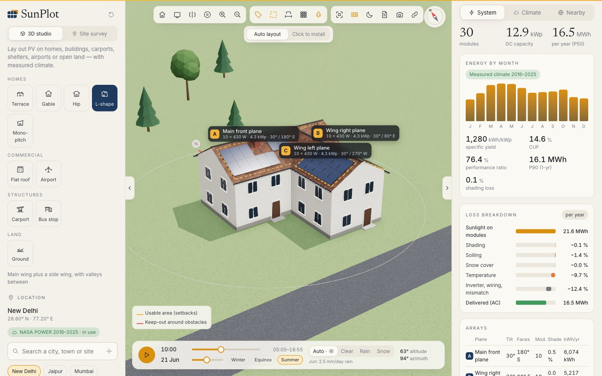</td>
  </tr>
  <tr>
    <td align="center"><sub><b>Carport</b> — Y-frames over 48 bays</sub></td>
    <td align="center"><sub><b>Bus shelters</b></sub></td>
    <td align="center"><sub><b>L-shape</b> — valleys handled</sub></td>
  </tr>
  <tr>
    <td width="33%">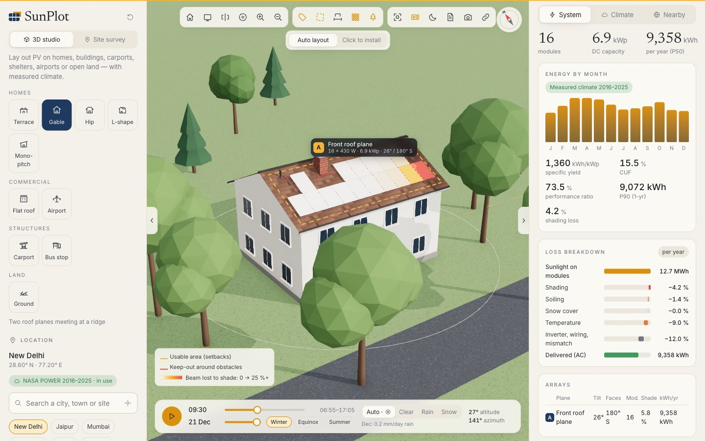</td>
    <td width="33%">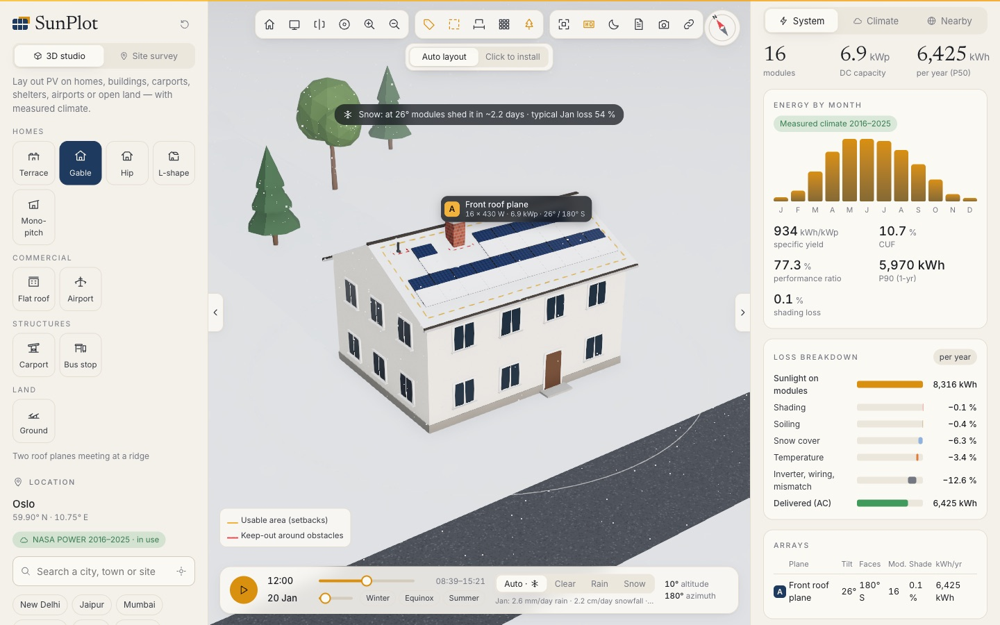</td>
    <td width="33%">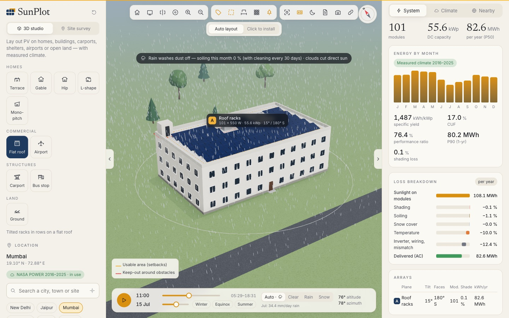</td>
  </tr>
  <tr>
    <td align="center"><sub><b>Shade heat-map</b> — 4.2 % loss from nearby trees</sub></td>
    <td align="center"><sub><b>Snow</b> — Oslo, January</sub></td>
    <td align="center"><sub><b>Rain</b> — Mumbai monsoon</sub></td>
  </tr>
</table>

## ✦ Quick start

> **Requires** Node.js 18+ and npm.

```bash
git clone https://github.com/ImliStack/SunPlot-3D.git
cd SunPlot-3D
npm install
npm run dev        # → http://localhost:5181
```

Climate data comes from NASA POWER the first time you open a place, then from the browser cache.

| Script | What it does |
|---|---|
| `npm run dev` | Dev server with hot reload on port 5181 |
| `npm run build` | Static production build into `dist/` |
| `npm run preview` | Serve `dist/` locally on port 5181 |

## ✦ Using SunPlot

<details open>
<summary><b>Design a system</b></summary>
<br />

Pick a site type on the left, then a place — search any town, use your location, or tap a quick pick.
Set the size, floors, roof pitch and the direction the roof faces; choose the module, portrait or
landscape, setbacks and obstacles. The layout fills the roof straight away and the right panel shows
modules, kWp, yearly energy, losses and money. Drag to orbit, scroll to zoom, right-drag to pan.

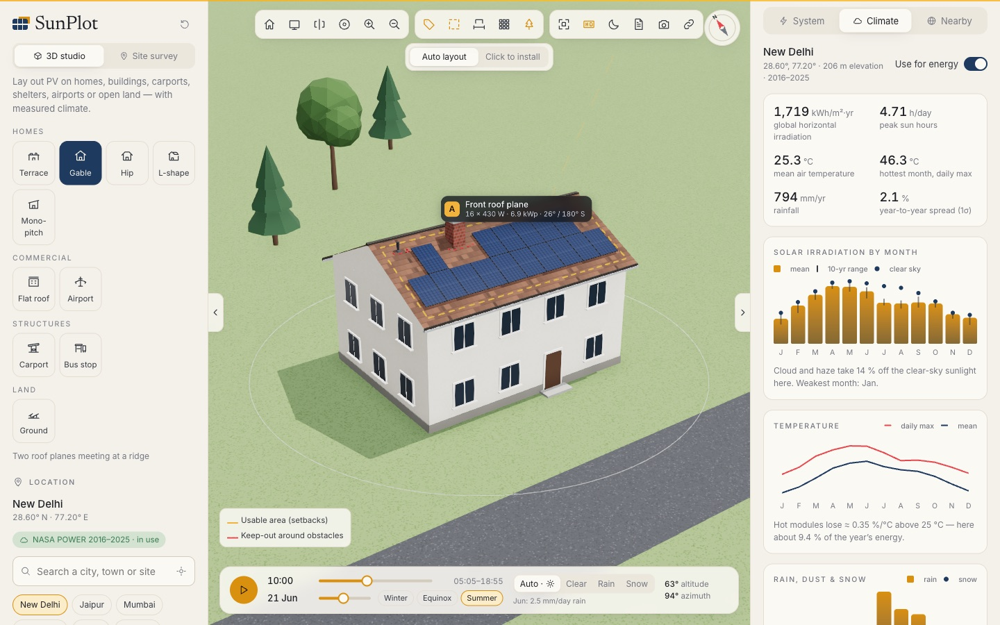

</details>

<details>
<summary><b>Install module by module</b></summary>
<br />

Switch **Auto layout** to **Click to install**. Every place a module fits glows blue; hover shows
what the next click does ("install this row · 23 modules").

| Tool | Click does | Key |
|---|---|:---:|
| Module | one module | <kbd>M</kbd> |
| Row | every module in that row | <kbd>R</kbd> |
| Column | every module in that column, all rows | <kbd>C</kbd> |
| Array | the whole roof plane / rack field | <kbd>A</kbd> |
| Paint | press and drag across slots — the first one decides add or remove | <kbd>P</kbd> |

Clicking an installed module removes it (or its row / column). **Fill all** starts from the auto
layout so you can take away what you don't want — the usual pro workflow.

</details>

<details>
<summary><b>Check shade, weather and climate</b></summary>
<br />

Turn on **Mature trees next to the site** under Shading for a shade study; the toolbar heat-map
colours each module by beam light lost. The **Climate** tab shows ten years of sunlight, temperature,
rain and snow for the place; the sun bar's weather switch shows it in 3D. **Nearby** lists real solar
plants around the site.

</details>

<details>
<summary><b>Send a proposal</b></summary>
<br />

Click the document icon in the toolbar, add the client's name, and download a five-page PDF.
[A sample is here](docs/sample-proposal.pdf).

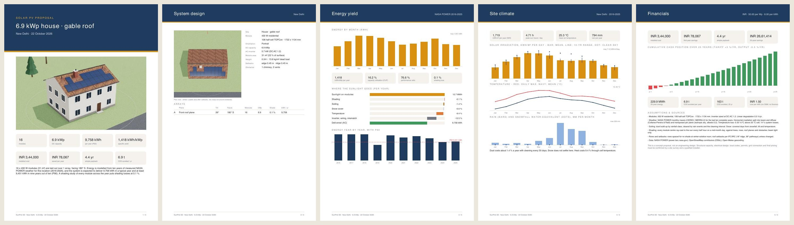

</details>

<details>
<summary><b>Share a design</b></summary>
<br />

The URL hash holds every input you changed — copy it from the address bar or use the link button.

| Link | Opens |
|---|---|
| `#site=carport&bays=20` | A carport with 20 bays per side |
| `#site=flat&length=30&width=18` | A 30 × 18 m flat roof |
| `#lat=59.9&lon=10.75&placeName=Oslo&day=20` | Oslo on 20 January |
| `#weather=snow` | The same design in snow |

</details>

## ✦ Keyboard shortcuts

| Key | Action | | Key | Action |
|:---:|---|---|:---:|---|
| <kbd>[</kbd> | Show / hide inputs | | <kbd>M</kbd> | Module tool |
| <kbd>]</kbd> | Show / hide results | | <kbd>R</kbd> | Row tool |
| <kbd>\\</kbd> | Focus mode (hide both) | | <kbd>C</kbd> | Column tool |
| <kbd>Ctrl</kbd>/<kbd>⌘</kbd> <kbd>Z</kbd> | Undo install step | | <kbd>A</kbd> | Array tool |
| <kbd>Shift</kbd> <kbd>Ctrl</kbd>/<kbd>⌘</kbd> <kbd>Z</kbd> | Redo | | <kbd>P</kbd> | Paint tool |

Tool keys and undo work in **Click to install** mode.

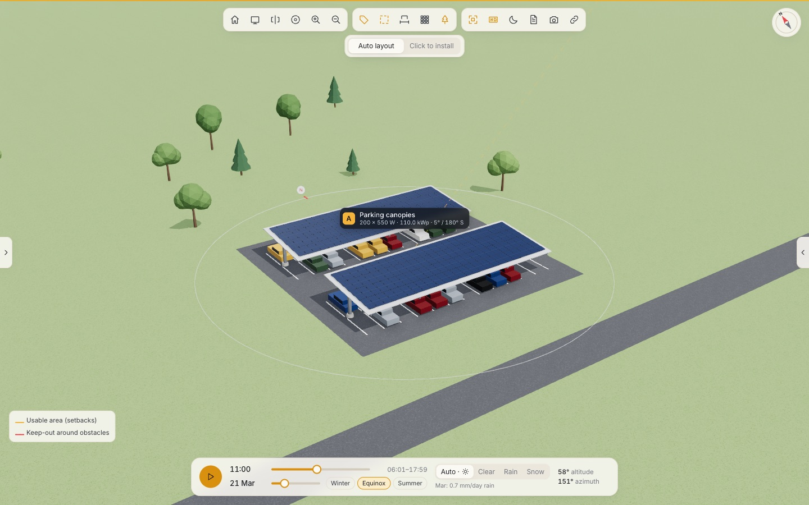

## ✦ How it works

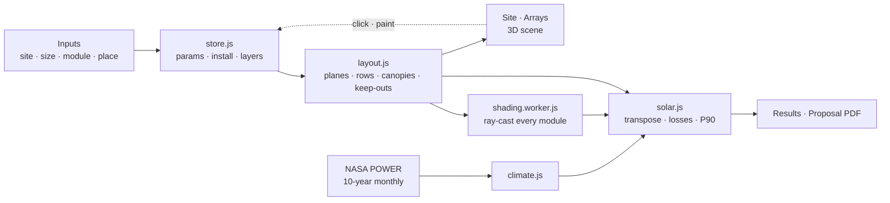

| Piece | Approach |
|---|---|
| **Layout** | `layout.js` is one pure function. Roofs become planes (eave, slope, usable half-width at each height — so hips and valleys come free); flat roofs and land become rack rows spaced for the winter-noon sun; canopies and shelters become tilted decks. Every module gets a stable key (array · row · position · stack). |
| **Rendering** | All modules are one instanced mesh with a painted cell texture; ghosts for click-to-install are a second instanced mesh. Buildings, trees, cars and aircraft are procedural — no model files. Reflections from a local `RoomEnvironment`, ambient occlusion from N8AO. |
| **Climate** | NASA POWER monthly all-sky / clear-sky irradiance, temperature, rain, snowfall and snow depth for the last ten complete years, cached in the browser. |
| **Energy** | Measured horizontal irradiation is split into beam and diffuse (Collares-Pereira & Rabl), transposed per plane, then reduced by ray-cast shading (beam only), Kimber-style soiling, snow cover, cell temperature (−0.35 %/°C) and 14 % system losses. Checked against PVGIS-class results within about 5 %. |
| **Shading** | `shading.js` puts module quads, roof planes, obstacle boxes and tree crowns in a plan grid and marches a ray to the sun from every module centre — 12 days × half-hourly, weighted by beam on that module. Runs in a Web Worker. |
| **Proposal** | `report.js` draws the PDF with jsPDF (vector charts, two 3D captures), loaded only when you make one. |

## ✦ Project structure

```text
SunPlot-3D/
├── index.html                  App shell, fonts, meta tags
├── package.json
├── vite.config.js
├── wrangler.jsonc              Cloudflare static-assets deploy
├── scripts/                    README screenshots + demo recording
├── PLAN.md                     Research notes, models and milestones
├── docs/
│   ├── logo.svg
│   ├── sample-proposal.pdf     Example client proposal
│   ├── demo.gif · demo.mp4     README demo
│   └── screenshots/            Images used in this README
└── src/
    ├── main.jsx                React entry
    ├── App.jsx                 Layout, toolbar, install bar, sun bar, weather, panels
    ├── store.js                Zustand store: inputs, install selection + undo, layers, camera
    ├── hooks.js                Candidate / built layout, yield, shading keys
    ├── links.js                URL hash ⇄ inputs
    ├── presets.js              Modules, site types, climates, places, defaults
    ├── layout.js               Layout engine: planes, rows, canopies, keep-outs, keys
    ├── solar.js                Sun position, clear sky, transposition, yield, soiling, snow
    ├── climate.js              NASA POWER fetch, cache, summary
    ├── shading.js              Ray-cast shading engine
    ├── shading.worker.js       Runs it off the main thread
    ├── shadingClient.js        Starts a study when the design changes
    ├── installTools.js         Module / row / column / array / paint targets
    ├── installations.js        OpenStreetMap lookup, landmark plants, geocoding
    ├── context.js              Site radius, trees (shared by scene and shading)
    ├── report.js               PDF proposal (jsPDF)
    ├── styles.css              Design tokens (light + dark), layout, components
    ├── scene/
    │   ├── Stage.jsx           Canvas, camera rig, post effects, snapshots
    │   ├── Site.jsx            Building / structure / plot + modules + overlays
    │   ├── Buildings.jsx       Houses, flat roof, terminal, bus stops, ground plot, obstacles
    │   ├── Structures.jsx      Canopy steel, car park, cars
    │   ├── Arrays.jsx          Modules (install, ghosts, heat-map) and racking
    │   ├── Overlays.jsx        Setback zones, keep-outs, array tags, dimensions
    │   ├── World.jsx           Sun, sky, ground, compass, trees, day clock
    │   ├── Weather.jsx         Rain, snow, snow cover
    │   ├── capture.js          Frame capture for PNG / PDF
    │   ├── parts.jsx           Shared geometry and materials
    │   └── textures.js         Canvas-painted textures
    └── ui/
        ├── Inputs.jsx          Left panel
        ├── Results.jsx         System / Climate / Nearby tabs
        ├── Proposal.jsx        PDF dialog
        ├── TagLayer.jsx        Projected labels over the canvas
        └── Icon.jsx            24 px stroke icon set
```

**Where to start reading:** [`src/layout.js`](src/layout.js) for where modules go,
[`src/solar.js`](src/solar.js) for the energy model,
[`src/scene/Arrays.jsx`](src/scene/Arrays.jsx) for click-to-install.

## ✦ Customising

| To… | Edit |
|---|---|
| Add a module type | `PANELS` in [`src/presets.js`](src/presets.js) — size, watts, weight |
| Add a quick-pick place | `PLACES` in [`src/presets.js`](src/presets.js) — lat, lon, climate, currency, cost, tariff |
| Change default sizes for a site type | `SITE_SIZES` in [`src/store.js`](src/store.js) |
| Tune losses | `SYSTEM_PR`, `TEMP_COEFF`, soiling and snow functions in [`src/solar.js`](src/solar.js) |
| Add a landmark installation | `LANDMARKS` in [`src/installations.js`](src/installations.js) |
| Change theme colours | CSS custom properties at the top of [`src/styles.css`](src/styles.css) |

## ✦ Browser support & deployment

Works in current **Chrome, Edge, Firefox and Safari** on desktop and mobile; WebGL must be available.
The **HQ** switch turns ambient occlusion off for slower devices.

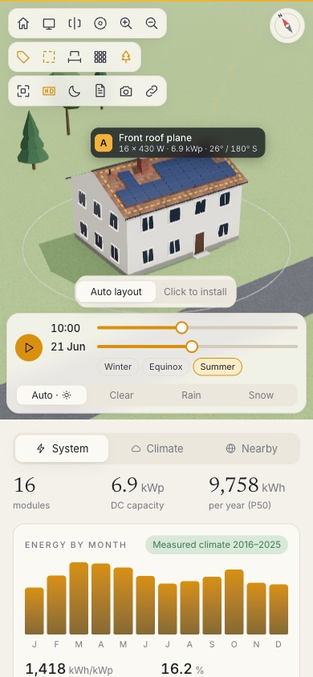

`npm run build` emits a fully static site in `dist/` — deploy it to **Cloudflare (Pages or Workers),
Vercel, Netlify or GitHub Pages** with no server and no environment variables. On Cloudflare
Workers Builds, [`wrangler.jsonc`](wrangler.jsonc) serves `dist/` as static assets
(build: `npm run build`, deploy: `npx wrangler deploy`). NASA POWER, OpenStreetMap
(Overpass) and Open-Meteo are called straight from the browser; none needs a key.

<br clear="right" />

## ✦ FAQ

<details>
<summary><b>How accurate is the energy number?</b></summary>
<br />
It is a concept estimate. On measured weather it lands within about 5 % of PVGIS-class tools for
the places checked (Delhi, Jodhpur, Kochi, London). Use PVsyst and a site survey before quoting.
</details>

<details>
<summary><b>Where does the climate data come from?</b></summary>
<br />
<a href="https://power.larc.nasa.gov/">NASA POWER</a> (CERES satellite irradiance, MERRA-2
reanalysis), monthly means on a ~0.5° grid for the last ten complete years.
</details>

<details>
<summary><b>Why does the Nearby tab sometimes fail?</b></summary>
<br />
It asks OpenStreetMap's public Overpass servers, which are often at capacity. Press Retry; the
landmark list below always works.
</details>

<details>
<summary><b>Can I use it to size a real installation?</b></summary>
<br />
For early design and client conversations, yes. Structural loads, electrical design, local codes,
permits and grid connection still need a qualified installer.
</details>

## ✦ Roadmap

- [x] Nine site types, code setbacks, obstacles, winter-sun row spacing
- [x] Ten-year measured climate, P50 / P90, loss waterfall
- [x] Ray-cast shading, rain / dust / snow losses, weather in 3D
- [x] Click to install by module, row, column, array or paint, with undo
- [x] Client proposal PDF, nearby and landmark installations
- [x] Remote site survey for Indian homes: satellite, building outlines, bill-based sizing, subsidy, roof zones
- [x] Schools, hospitals, banks, supermarkets, malls and petrol pumps in the survey, with a 3D map and styled facades
- [ ] Pitched roofs and multi-level terraces in the survey
- [ ] Customer leads, bill upload and vendor quotes (separate backend)
- [ ] Strings, inverters and MPPT assignment with voltage checks
- [ ] Hourly TMY weather (PVGIS / NREL) and bifacial gain
- [ ] Wind and snow load zones per region
- [ ] Bill of materials export (CSV) and branded proposal themes
- [ ] Battery sizing and self-consumption from a load profile

Research notes and earlier milestones are in [PLAN.md](PLAN.md).

## ✦ Screenshots & demo

Every image and the demo in this README are generated from the running app:

```bash
npm run dev                    # keep running on :5181
scripts/readme-shots.sh        # refreshes docs/screenshots/*.jpg
scripts/readme-video.sh        # records docs/demo.mp4 + docs/demo.gif (needs ffmpeg)
```

Both use the gstack `browse` CLI in headed mode (WebGL needs a real GPU). They are re-run before
each push that adds features, so the README always shows the current app. For an inline video
player instead of the GIF, drag `docs/demo.mp4` into the README in GitHub's web editor — GitHub
hosts it and plays it in place (MP4 / MOV / WebM).

## ✦ Contributing

Issues and pull requests are welcome.

1. Fork the repo and create a branch: `git checkout -b feature/your-idea`
2. Run `npm run dev` and make your change
3. Check `npm run build` passes
4. Open a pull request describing what changed and why

## ✦ Data & credits

| Source | What | Licence / terms |
|---|---|---|
| [NASA POWER](https://power.larc.nasa.gov/) | Monthly irradiance, temperature, rain, snow | Public, free use with attribution |
| [OpenStreetMap](https://www.openstreetmap.org/copyright) via Overpass | Solar plants near the site | ODbL |
| [Open-Meteo](https://open-meteo.com/) | Place search (geocoding) | CC BY 4.0 |
| [Overture Maps](https://overturemaps.org/) | Building outlines, heights and places (survey) | ODbL / CC BY 4.0 |
| [Esri World Imagery](https://www.arcgis.com/home/item.html?id=10df2279f9684e4a9f6a7f08febac2a9) | Satellite base map (survey) | Esri terms — check before commercial use |
| [MapLibre GL JS](https://maplibre.org/) | Survey map | BSD-3 |
| [three.js](https://threejs.org), [React Three Fiber](https://github.com/pmndrs/react-three-fiber), [drei](https://github.com/pmndrs/drei), [postprocessing](https://github.com/pmndrs/postprocessing) | 3D rendering | MIT |
| [jsPDF](https://github.com/parallax/jsPDF) | Proposal PDF | MIT |
| Google Fonts | Newsreader, Inter | OFL |

> [!IMPORTANT]
> **Concept estimates only.** SunPlot is a planning and sales tool, not an engineering design or
> a bankable yield report.

<div align="center">
<br />
<sub>Made with care by <a href="https://github.com/ImliStack">ImliStack</a></sub>
</div>
